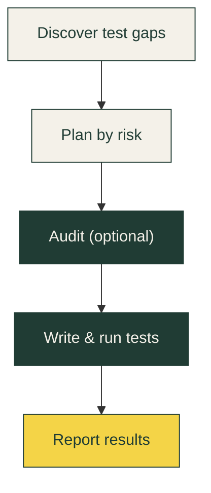

<h1 align="center">Sheriff</h1>

<div align="center">
  
</div>

<h2 align="center">Big ideas. <em>Fewer blind spots.</em></h2>

<p align="center">
  Sheriff finds test gaps, writes and runs tests, and keeps them aligned with your changes—in Claude Code or Codex.
  <br>
  <em>A deputy for your codebase.</em>
</p>

<p align="center">
  <a href="https://www.npmjs.com/package/@dagim_codes/sheriff"></a>
  <a href="LICENSE"></a>
  <a href="#install"></a>
  <a href="#use"></a>
</p>

<p align="center">
  <a href="https://sheriff.dagim.codes">Website</a> ·
  <a href="https://sheriff.dagim.codes/docs">Field guide</a> ·
  <a href="#install">Quick start</a> ·
  <a href="#how-it-works">How it works</a>
</p>

---

## Install

*Saddle up. A small install. A better habit.*

```bash
npx @dagim_codes/sheriff
```

Choose Claude Code, Codex, or both, then project or user scope. Open your AI tool in the project and start:

| Claude Code | Codex |
| --- | --- |
| `/sheriff:run` | `$sheriff run` |

Sheriff uses your existing AI session and test runner; no separate model API key is required. Restart your tool if the newly installed commands or skill aren't visible yet.

Explicit install commands:

```bash
npx @dagim_codes/sheriff --tool claude --local
npx @dagim_codes/sheriff --tool codex --local
npx @dagim_codes/sheriff --tool both --global
```

`--tool claude,codex` also selects both. Existing commands with `--local` or `--global` but no `--tool` target Claude Code. Non-interactive use requires a scope; add `--silent` to suppress normal output. `npm install` downloads the package; `npx` runs the installer.

Requirements: Node.js 18+, a supported AI tool with file/shell access, and a JavaScript or TypeScript project. Sheriff reuses existing runners and can help configure a missing runner within your authorized scope. Browser/service-dependent tests require their own working environment.

## From your first test to every change after

A lot can hide between *“it works”* and *“it’s tested.”* Choose the workflow that fits the work in front of you.

| Workflow | What Sheriff does |
| --- | --- |
| **Run** | **Cover the unknown.** Map test gaps, plan by risk, and write and run tests with your project's runner. Resume unfinished work with saved handoffs. |
| **Audit** | **Look a little closer.** Review source defects and report findings. You choose which fixes to authorize. |
| **Sync** | **Keep it covered.** Review current source changes and update affected tests, including missing assertions when existing tests still pass. |

## How it works

Sheriff guides your AI tool through specialized testing roles, keeping the plan and results in your project.



Auditing is optional. After source changes, use **Sync** to review the changes and bring affected tests up to date.

Sheriff supplies instructions and a local state CLI. Your AI tool performs the code analysis and edits. Test generation quality still depends on the project, runner setup, and model; a file inventory is not a measured coverage percentage.

## Use

| Operation | Claude Code | Codex |
| --- | --- | --- |
| Run or resume | `/sheriff:run` | `$sheriff run` |
| Audit before testing | `/sheriff:run --audit` | `$sheriff run --audit` |
| Test without auditing | `/sheriff:run --no-audit` | `$sheriff run --no-audit` |
| Sync worktree changes | `/sheriff:sync` | `$sheriff sync` |
| Audit source | `/sheriff:audit` | `$sheriff audit` |
| Progress | `/sheriff:status` | `$sheriff status` |
| Configuration | `/sheriff:configure` | `$sheriff configure` |
| Help | `/sheriff:help` | `$sheriff help` |

Restart the host if newly installed commands or skills are not yet visible. Codex uses a self-contained [Agent Skill](https://learn.chatgpt.com/docs/build-skills); Claude Code uses commands and role instructions. Host permissions and repository instructions apply in both tools.

Run discovers sources/tests, builds a phase plan, executes dependency-ordered work, and reports evidence. Pending handoffs resume before new eligible work. Review/fail items remain visible and are not retried indefinitely. `run --phase N` explicitly retries review/fail items in one existing phase while preserving passing work. `run --from-scratch` archives the old plan and evidence, keeps configuration/tests, and regenerates discovery.

Sync selects **current staged, unstaged, and untracked source changes** by default. A clean worktree has no sync work. Choose one alternative selector:

- `--files src/a.ts,src/b.ts`: specific source paths.
- `--staged`: staged paths, tested using their current working-tree contents.
- `--since-commit <ref>`: changes from that commit to the working tree.
- `--since-branch <branch>`: changes from the merge base to the working tree.

Sync audits by default; `--no-audit` disables review. Passing old tests are also checked for missing assertions for changed behavior. Source fixes respect the configured policy and user authorization; tests are not weakened to conceal a regression.

## Configuration and state

Configuration lives at `.sheriff/.sheriff.json`. Onboarding detects the project and asks about unresolved choices. Configure can change those settings without resetting existing progress.

| Field | Purpose |
| --- | --- |
| `testTypes` | Enable unit and/or E2E tests |
| `testRunners` | Runner names per type; disabled types use null |
| `sourceDirs`, `excludeDirs`, `excludePatterns` | Discovery scope |
| `phaseStrategy` | `risk`, `domain`, or `complexity` |
| `onTestFailure` | `flag` (default), `fix`, or `fix+notify` |
| `maxParallelAgents` | Maximum delegated workers where supported |
| `models` | Optional host-supported light/medium/heavy preferences |
| `staleLockMinutes` | Signals a potentially stale claim; not permission to start a second writer |

`flag` reports source defects without modifying source. Other policies allow scoped source fixes only within user authorization. Codex executes roles sequentially with the current model, preserving shared preferences but ignoring Claude model/delegation settings. Claude Code can delegate disjoint work when available and authorized. Workers sharing test files, configuration, or external fixtures must run sequentially.

```text
.sheriff/
├── .sheriff.json        # Project configuration
├── TEST_MAP.md          # Source/test inventory and known gaps
├── PHASES.md            # Phase metadata, ownership, dependencies, status
├── results/            # Per-sub-phase execution evidence
├── results-assembled.md
├── audits/             # Source findings and authorized fixes
├── sync/               # Change/test synchronization reports
├── summaries/          # Phase summaries
├── handoffs/           # Pending work for resumption
└── archive/            # Evidence retained when replanning/retrying
```

Both integrations share this directory. **Run one Sheriff orchestrator per project at a time.** Tests remain in your project's normal test directories. Keep `.sheriff/` in Git or ignore it according to your team conventions; review generated reports before sharing.

`reset --discovery-only` archives the old plan, maps, results, handoffs, and reports while preserving configuration and tests. `reset` (or `reset --full`) deletes `.sheriff/`, including its configuration and archives. It preserves source/test files outside that directory and refuses to proceed while workers are active.

## Safety and evidence

- No automatic commits, whole-worktree staging, hard resets, or cleaning untracked files. Authorized commits use reviewed, explicit file scope after workers settle. The Git checkpoint helper records HEAD; it does not save uncommitted files.
- Existing tests are reused by actual source mapping and test type. Unit and E2E suites may legitimately cover the same source.
- Failed regressions remain failures. At most three corrective attempts are made per sub-phase; skips, missing infrastructure, and unresolved findings stay visible.
- A successful test result requires actual execution, a successful exit, and at least one passing test. Empty/all-skipped suites and unexecuted browser tests do not prove success.
- Test counts distinguish existing cases from newly added ones and disclose overlapping runs. Coverage percentages require an actual runner coverage report.

Claude installation includes a statusline and context monitor while preserving a custom statusline. Automatic context warnings require fresh metrics from Sheriff's statusline for the same session/project; they are unavailable with a custom statusline and are not forwarded from a parent session to subagents. Workers must save handoffs before stopping independently of these optional warnings. Codex installs neither hook nor statusline.

## Update and uninstall

Use the same tool and scope as installation:

```bash
npx @dagim_codes/sheriff@latest --tool codex --local
npx @dagim_codes/sheriff --tool codex --local --uninstall
```

Choose `--tool both` for both integrations. Installed `update` commands retain their tool and scope. Updates/uninstall preserve project `.sheriff/` and tests. The installer tracks its files, preserves unknown files/settings, and refuses unrelated destination collisions. Normal I/O failures roll back installation writes; abrupt process or machine termination is not a transactional filesystem guarantee.

| Integration | Project scope | User scope |
| --- | --- | --- |
| Claude commands | `.claude/commands/sheriff/` | `~/.claude/commands/sheriff/` |
| Claude roles/runtime | `.claude/agents/sheriff-*.md`, `.claude/sheriff/` | Same paths under home |
| Claude settings/hooks | `.claude/settings.json`, `.claude/hooks/` | Same paths under home |
| Codex skill/runtime | `.agents/skills/sheriff/` | `~/.agents/skills/sheriff/` |

Codex installation does not modify AGENTS.md or Codex configuration. Local runtime references are relative; Claude hook registration should be rerun after moving a project to another machine. Other AI tools are not yet supported integrations.

## Benchmarks

Local runtime snapshot (2026-10-16): Apple M4 Pro, darwin/arm64, Node v22.18.0. Medians from 15 samples after 3 warmups. Measured source: `eb6a9e0` plus uncommitted changes; the exact runtime hash and raw samples are in the [snapshot](benchmarks/snapshots/2026-10-16-local.json).

| Sub-phases | Parse plan | Status CLI |
| --- | ---: | ---: |
| 3 | 0.005 ms | 25.464 ms |
| 100 | 0.118 ms | 25.207 ms |
| 1,000 | 0.869 ms | 29.488 ms |

These are synthetic canonical plans without result summaries; CLI timings include Node startup. This development snapshot is not a release or hosted CI baseline, and does not measure AI workflow speed.

Run `npm run benchmark`. The [benchmark workflow](.github/workflows/benchmark.yml) produces PR base/head comparisons in Actions summaries and retains raw results for 30 days. [Methodology and durable history](benchmarks/README.md) describe how to reproduce measurements and save release snapshots.

## Development and verification

```bash
npm test
npm run benchmark
npm pack --dry-run
```

There are no package dependencies. Hook builds use Node's syntax check and copy the standalone scripts. `pretest` and `prepack` rebuild hooks; `prepublishOnly` runs tests. Tests use temporary homes/projects for installation, runtime state, recovery, and packaging contracts.

`npm run --silent benchmark -- --json` emits machine-readable samples and provenance. `npm run --silent benchmark:report -- <current.json> [baseline.json]` renders a Markdown summary, suppressing percentage comparisons for incompatible runs. Both commands run locally without model or network calls.

These checks do not prove live model-driven test generation in Claude Code or Codex, every framework/runner combination, or production/browser-service behavior. Before release, exercise the complete run/resume/audit/sync flow in each host against disposable example projects.

To run opt-in acceptance tests with the corresponding installed, authenticated host CLI:

```bash
npm run test:live:codex
npm run test:live:claude
```

These consume normal model usage. They pack the current checkout, install it in a temporary project, and start fresh host sessions for help, run, audit, pause, resume, sync, and status. Independent checks rerun generated tests, verify a seeded bug and a behavior mutation are caught, and check that unrelated work survives. The harness prints its evidence directory containing prompts, JSONL transcripts, test output, and `report.json`; it retains the fixture for inspection. Each session has a ten-minute timeout. Codex uses its default model, user configuration disabled, and workspace-write sandboxing. Claude uses its default model, project/local settings, sandboxed shell commands without unsandboxed retries, and hook-event capture. Authentication/provider denials stop the test and are recorded as blocked. These tests are separate from `npm test` and CI; they do not cover interactive UI, delegated workers, or browser/E2E runners.

## Contributing

See the [contributor guide](CONTRIBUTING.md) for setup, checks, pull requests, and the release policy. Discuss substantial features in an issue before implementing them.

Participation follows the [Code of Conduct](CODE_OF_CONDUCT.md). Report vulnerabilities privately using the [security policy](SECURITY.md).

## License

MIT. See [LICENSE](LICENSE).
